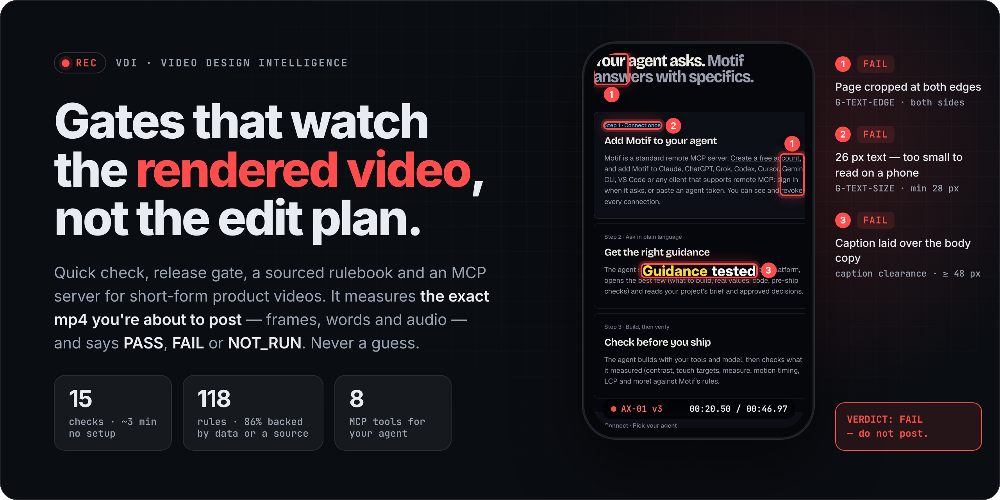
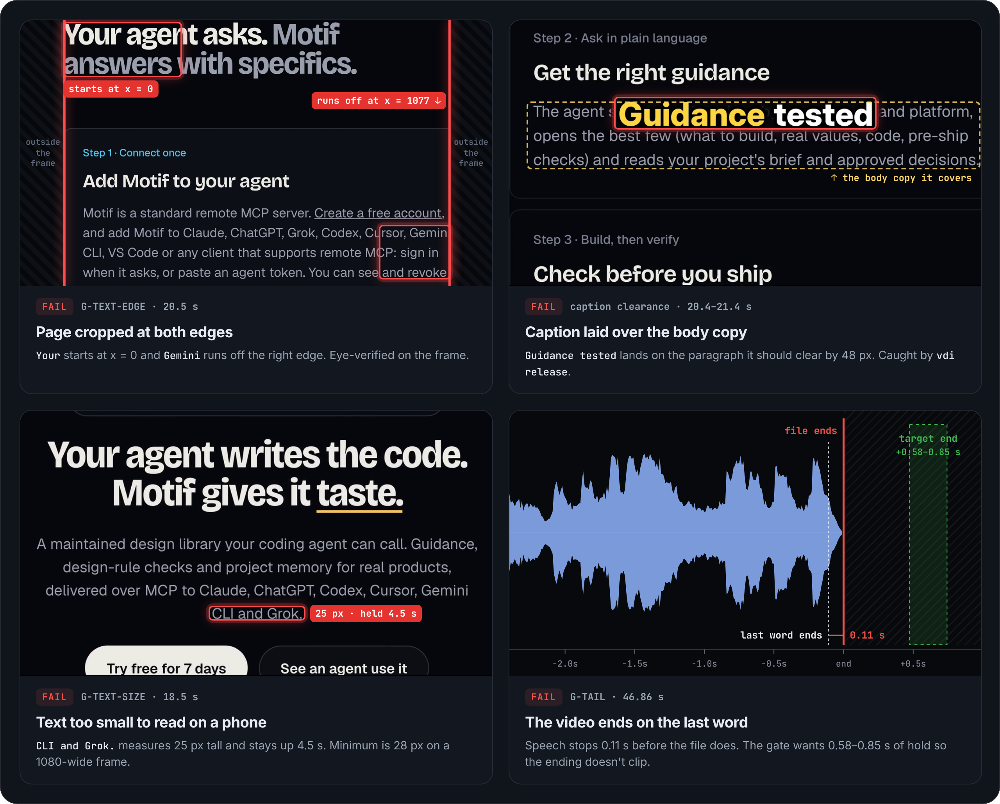
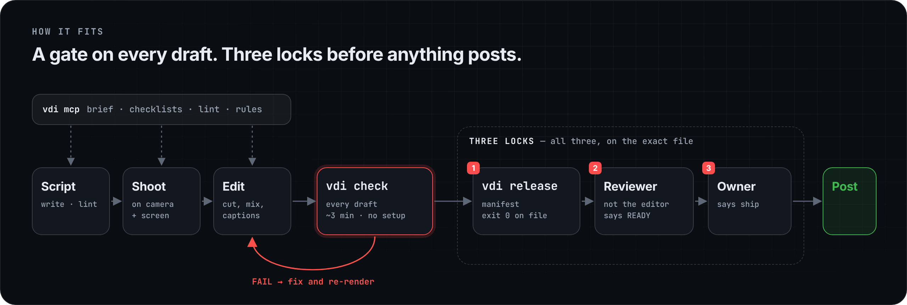
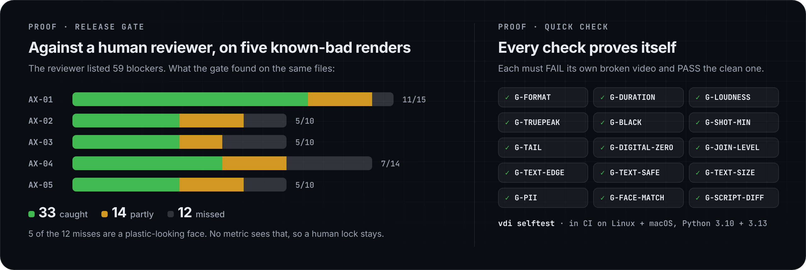

<div align="center">

<picture>
  <source media="(prefers-color-scheme: dark)" srcset="docs/assets/hero-dark.png">
  <source media="(prefers-color-scheme: light)" srcset="docs/assets/hero-light.png">
  
</picture>

[](https://github.com/ASV-Labs/vdi/actions/workflows/ci.yml)
[](LICENSE)
[](corpus/LICENSE)
[](pyproject.toml)
[](docs/mcp.md)


**[Quickstart](#quickstart) · [How it works](#how-it-works) · [Use it from an agent](#use-it-from-an-agent-mcp) · [Proof](#proof) · [The rulebook](#the-rulebook)**

</div>

<br>

**VDI checks the video file you're about to post, not the plan you edited from.** It reads the frames, hears
the words and measures the audio, then tells you exactly what's wrong and at what second. Use it from the
terminal, in CI, or let your coding agent call it over MCP.

> [!NOTE]
> **Why it exists.** We made five 40–47 s vertical shorts: a founder on camera, real terminal and web screens.
> After four edit rounds the editor's own checker said **22/22 passed**. An independent reviewer found
> **19 blocking defects**: captions that didn't match the words, lines cropped at the frame edge, a flash shot
> at the hook, endings cut on the last consonant, a masked email still on screen. The checker had graded the
> edit plan against itself. Every rule here traces to one of those defects or to a cited source.

## See it run



<sub>A real run on one of those known-bad renders (15 checks, ~3 min on 2 CPU cores), condensed. Values unchanged; one email redacted.
Every line names the check, the second it happened and the threshold it missed.</sub>

### What it found on that render

<picture>
  <source media="(prefers-color-scheme: dark)" srcset="docs/assets/defects-dark.png">
  <source media="(prefers-color-scheme: light)" srcset="docs/assets/defects-light.png">
  
</picture>

These are frames and audio from the actual file, not mock-ups. Each one is something the editor's checklist
passed and a viewer would have seen.

## How it works

<picture>
  <source media="(prefers-color-scheme: dark)" srcset="docs/assets/pipeline-dark.png">
  <source media="(prefers-color-scheme: light)" srcset="docs/assets/pipeline-light.png">
  
</picture>

| | What it is | When you use it |
|---|---|---|
| **`vdi check`** | Quick gate. 15 checks on any rendered video, **no setup**: format, loudness and true peak, flash shots, black panels, the hold after the last word, digital-zero dropouts, level steps at joins, OCR for cropped / unsafe-zone / too-small text, emails and keys on screen, face colour across cuts, said-vs-scripted. | Every draft. Minutes on a laptop. |
| **`vdi release`** | Release gate. Checks the render against a **manifest** you write before the edit: the script, proper nouns, and evidence beats ("this exact line must be readable on screen while this claim is spoken"). Two Whisper models must agree on every word; word endings are compared with the source takes. | Once, on the exact file you'll post. Lock 1 of 3. |
| **`vdi mcp`** | MCP server so Claude, Cursor or any MCP client can plan a short, lint the script, pull the right checklist and run the quick gate. | While you plan, write and edit. |
| **`corpus/`** | 13 topic packs, 118 rules with ids, checklists, real examples with timestamps. Every claim is labelled measured, cited or unverified. | When you want the *why* behind a check. |

A check that couldn't run prints **`NOT_RUN`**, never `PASS`. Exit codes everywhere: **0** pass · **1** fail ·
**2** couldn't run, so it drops straight into CI or a pre-publish script.

## Quickstart

**1 · Install** (Python 3.10+, ffmpeg and tesseract)

```bash
git clone https://github.com/ASV-Labs/vdi && cd vdi
pip install -e ".[mcp]"
brew install ffmpeg tesseract            # or: sudo apt-get install ffmpeg tesseract-ocr
```

`vdi` checks for ffmpeg and tesseract before it runs and prints the install line if one is missing.

**2 · Prove it works on your machine** (~90 s)

```bash
vdi selftest --keep                      # builds a clean short + one broken short per check, in ./vdi-selftest-fixtures
vdi check vdi-selftest-fixtures/bad_tail.mp4      # watch one fail: the video ends on the last word
```

**3 · Check your own video**

```bash
vdi check final.mp4 --platform instagram-reels    # youtube-shorts · tiktok · instagram-reels · x · linkedin · youtube-long
vdi check final.mp4 --json --out report.json      # machine-readable, for CI
```

<details>
<summary><b>Run the full release gate</b> (manifest, two ASR models, ~8–10 min per short)</summary>

<br>

```bash
pip install -e ".[release]"              # faster-whisper, opencv, scipy
vdi release final.mp4 --manifest final.manifest.json
```

Start a manifest from a real one in [`examples/v4/manifests/`](examples/v4/manifests/). The first run downloads two
Whisper models (~2 GB); results are cached per file and progress is logged as it goes. Full reference:
[docs/release-gate.md](docs/release-gate.md).

</details>

## Use it from an agent (MCP)

Point your agent at VDI and it plans the short with real numbers instead of vibes: platform safe zones with
sources, a timed shot list, script rules, the thresholds the gate will hold the render to.

<details open>
<summary><b>Claude Code</b></summary>

```bash
claude mcp add vdi -- vdi mcp
```

</details>

<details>
<summary><b>Claude Desktop</b> · <code>claude_desktop_config.json</code></summary>

```json
{ "mcpServers": { "vdi": { "command": "vdi", "args": ["mcp"] } } }
```

Use the absolute path from `which vdi` if Claude Desktop doesn't inherit your shell's PATH.

</details>

<details>
<summary><b>Cursor</b> · <code>.cursor/mcp.json</code></summary>

```json
{ "mcpServers": { "vdi": { "command": "vdi", "args": ["mcp"] } } }
```

</details>

<details>
<summary><b>Any other MCP client</b></summary>

VDI is a standard stdio server: command `vdi`, args `["mcp"]`. Details: [docs/mcp.md](docs/mcp.md).

</details>

Then just ask:

> *"Use vdi_brief to plan a 45-second YouTube Short demoing our CLI, me on camera plus a terminal recording.
> Then lint this script with vdi_lint_script."*

> *"Run vdi_quick_gate on renders/final-v3.mp4 for TikTok and tell me what to fix first."*

| Tool | What it returns |
|---|---|
| `vdi_brief` | **Start here.** A production brief for one short: platform notes with sources, a timed shot-list skeleton, script and capture rules, edit thresholds, the review plan and a manifest template. |
| `vdi_lint_script` | Sentence length, lines too long for the prompter board, claims that need on-screen proof, proper nouns to check by ear, hook length. |
| `vdi_checklist` | Every rule for one stage (script, shoot, pickups, screen, edit, captions, audio, review, publish) with its check and provenance. |
| `vdi_quick_gate` | Runs `vdi check` on a rendered file and returns the report. |
| `vdi_search` · `vdi_get` | Search the rulebook by text, pack or stage; fetch one rule, pack, lesson or source by id. |
| `vdi_gate_spec` · `vdi_list_topics` | The gate's checks and thresholds; the 13 packs. |

A contributor tool that writes to the lessons inbox, `vdi_log_lesson`, is off unless you set `VDI_ENABLE_WRITE_TOOLS=1`.

## Proof

<picture>
  <source media="(prefers-color-scheme: dark)" srcset="docs/assets/proof-dark.png">
  <source media="(prefers-color-scheme: light)" srcset="docs/assets/proof-light.png">
  
</picture>

- **Release gate:** per-file receipts, manifests and what was missed, line by line → [docs/release-gate-proof-v4.md](docs/release-gate-proof-v4.md)
- **Quick check:** all five known-bad v3 renders FAIL; each finding eye-checked against the frame → [docs/quick-check-v3.md](docs/quick-check-v3.md)
- **In CI** on every push (Linux + macOS, Python 3.10 + 3.13): `vdi validate`, 9 CLI tests, a real stdio MCP handshake, 19 guidance evals and the full self-test.

## The rulebook

13 packs, one per stage of making a short. Each has `RULES` (with ids), `KNOWLEDGE`, `CHECKLISTS`, `EXAMPLES`
from the real series, its sources, and a **Known gaps** section.

| # | Pack | Rules | What it covers |
|---|---|---:|---|
| 01 | [Scripting and boards](corpus/01_Scripting_and_Boards/) | 11 | Lines you can say in one breath, caption in two short lines, and prove on screen |
| 02 | [Talking-head capture](corpus/02_Talking_Head_Capture/) | 9 | Camera, light, framing, mic and room that don't need rescue in the edit |
| 03 | [Pickups and continuity](corpus/03_Pickups_and_Continuity/) | 8 | Replacement lines the viewer can't hear or see the join in |
| 04 | [Screen capture and demos](corpus/04_Screen_Capture_and_Demos/) | 12 | Real runs, readable at phone size, no personal data or plan walls |
| 05 | [Editing and pacing](corpus/05_Editing_and_Pacing/) | 12 | Shot lengths, holds on evidence, word tails at cuts, endings |
| 06 | [Captions and on-screen text](corpus/06_Captions_and_On_Screen_Text/) | 9 | Verbatim captions in their own band, never over other text |
| 07 | [Audio](corpus/07_Audio/) | 9 | Cleanup that doesn't damage words, loudness and true peak, joins with room tone |
| 08 | [Colour and face](corpus/08_Colour_and_Face/) | 5 | Faces that match across cuts and don't look plastic |
| 09 | [Platform formats](corpus/09_Platform_Formats/) | 7 | What TikTok, Reels, Shorts and X document, and what's only hearsay |
| 10 | [Hooks and retention](corpus/10_Hooks_and_Retention/) | 7 | What the first seconds must do, and the honest gap in the data |
| 11 | [Review and QA](corpus/11_Review_and_QA/) | 9 | Gates on the render, independent review, blind A/B, owner sign-off |
| 12 | [Claims and honesty](corpus/12_Claims_and_Honesty/) | 7 | Every claim shown by real footage from the same run |
| 13 | [Anti-patterns](corpus/13_Anti_Patterns/) | 13 | The named failures, how they show up, and which check catches them |

**How to read a claim:** `[AX …]` was measured on the series, `[SRC …]` is cited with an access date,
`[UNVERIFIED]` is a house rule nobody has proven yet. **101 of 118 rules (86%)** rest on a measurement or a
source; the other 17 say so. `vdi validate` prints the counts. More: [corpus/README.md](corpus/README.md).

## What it can't catch

No metric here can judge a plastic-looking face, a voice that sounds processed, whether a claim is *true*
(only whether its proof line is readable while it's said), whether footage is really from the run it claims,
or anything the manifest forgot to declare. That's why "final" takes three locks: the gate passes on the exact
file, **an independent reviewer** (not the editor) says READY, and **the owner** says so. See [AGENTS.md](AGENTS.md).

> [!IMPORTANT]
> **Status, plainly.** v0.1.0, agent-written and **not yet reviewed by a human**. The evidence comes from one
> series (one presenter, one room, one product), and none of those videos has posted yet, so no rule is backed
> by watch-time data. We also don't have a human-verified *good* real render yet, so false alarms on finished
> footage aren't measured. Two false-positive classes found on real footage are fixed and covered by the
> self-test (animated split-screen transitions read as cuts; face-detector misfires, which now report `WARN`).
> If a check flags something on your video that isn't there, please [open an issue](CONTRIBUTING.md#reporting-a-gate-error).

## FAQ

<details>
<summary><b>Does it need a GPU or an API key?</b></summary>

<br>No. Everything runs locally on CPU: ffmpeg, tesseract OCR and, for the release gate, faster-whisper. Nothing
is uploaded anywhere.
</details>

<details>
<summary><b>Will it work on my videos, not just yours?</b></summary>

<br><code>vdi check</code> needs no manifest and works on any rendered file. The thresholds are tuned for
vertical short-form (9:16, under ~3 min) and you pick the platform with <code>--platform</code>.
<code>youtube-long</code> covers 16:9, but most rules were measured on vertical shorts, so expect fewer of them to apply.
</details>

<details>
<summary><b>How long does it take?</b></summary>

<br><code>vdi check</code>: about 3 minutes for a 45 s short on 2 CPU cores. <code>vdi release</code>: 8–10 minutes,
cached per file after that.
</details>

<details>
<summary><b>Can I use the rules without the code?</b></summary>

<br>Yes. The corpus is plain Markdown under CC BY 4.0. Read it, fork it, cite it.
</details>

<details>
<summary><b>Windows?</b></summary>

<br>Untested. CI covers Linux and macOS on Python 3.10 and 3.13.
</details>

## Repo layout

```text
vdi/              code: CLI, quick gate, release gate, corpus engine, MCP server, validator, self-test
corpus/           13 topic packs + lessons (CC BY 4.0)
examples/v4/      real manifests and gate receipts from the five known-bad v4 renders (footage not published)
examples/v3/      verified `vdi release` output on AX-01 v3
docs/             release gate, quick check, MCP, proofs
tests/            CLI tests, MCP smoke test, guidance evals
```

`ax:<record>` in a citation means an internal production record (edit notes, review notes, measurement
scripts) that isn't published; the lessons and gate receipts are.

## Contributing

The most useful contributions are **a real file the gates get wrong** and **a defect from a real edit that no
rule covers**. A lesson becomes a rule, and a rule becomes a gate check only with a known-bad fixture that
proves it. How: [CONTRIBUTING.md](CONTRIBUTING.md).

<br>

<div align="center">

Built by [ASV Labs](https://github.com/ASV-Labs) · [@ASaltyVet](https://x.com/ASaltyVet)

<sub>Code MIT ([LICENSE](LICENSE)) · corpus, docs and examples CC BY 4.0 ([corpus/LICENSE](corpus/LICENSE)) · bundled test fonts DejaVu ([NOTICE](NOTICE))</sub>

</div>
